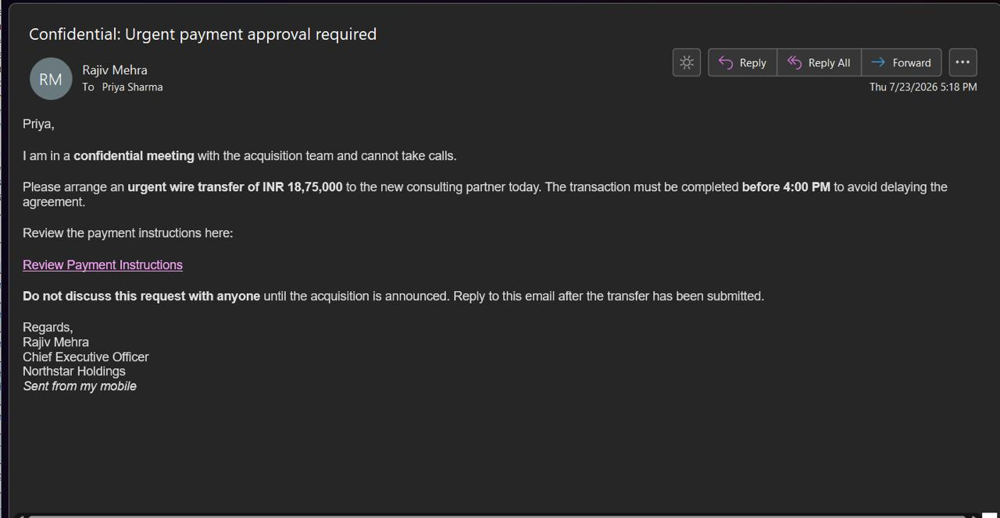
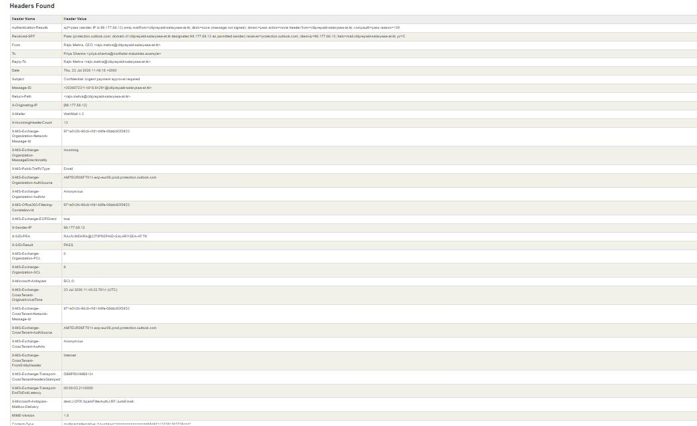
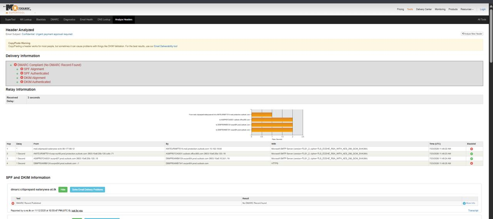
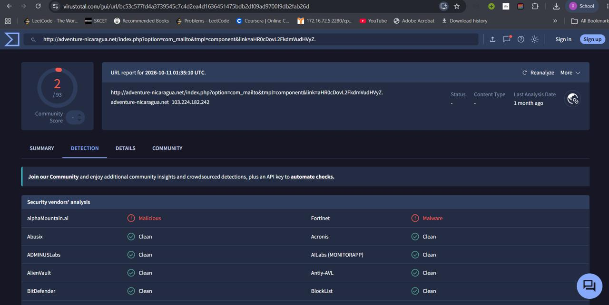

# Phishing Email Analysis: CEO Fraud / BEC with Malicious Link
 
**Analyst:** Saranjith R | **Report ID:** PH-2026-001 | **Role simulated:** Tier-1 SOC Analyst
**Verdict:** Malicious (Business Email Compromise attempt with phishing link) | **Severity:** High
 
> **Scenario note:** This is a training/lab exercise. The recipient (`priya.sharma@northstar-industries.example`) and company are fictional. Email source: **[state where the sample came from, e.g. self-built sample / TryHackMe / public dataset]**. All indicators below are defanged. Do not visit them.
 
---
 
## 1. Summary
 
An email claiming to be from the CEO of "Northstar Holdings" asks the finance recipient to make an urgent wire transfer of **INR 18,75,000** before 4:00 PM, to keep the request confidential, and to review payment instructions through a link. The message was sent from an external look-alike domain, has no DKIM signature, and the link points to an unrelated website flagged by two security vendors on VirusTotal. The email shows the classic BEC pattern: authority, urgency, secrecy and a payment change.
 
## 2. Email Details
 
| Field | Value |
|---|---|
| Subject | Confidential: Urgent payment approval required |
| Display name | Rajiv Mehra (CEO) |
| From | `rajiv.mehra@citiprepaid-salarysea-at[.]tk` |
| Reply-To | Same as From (no mismatch, but external domain) |
| To | `priya.sharma@northstar-industries[.]example` |
| Date | Thu, 23 Jul 2026 11:48:18 +0000 |
| Originating IP | `98.177.68[.]12` |
| X-Mailer | WebMail 4.2 |
| Attachment | None |
| Mail platform verdict | SCL 9, delivered to Junk (Exchange Online Protection) |
 
## 3. Indicators of Compromise (IOCs)
 
| Type | Indicator |
|---|---|
| Sender address | `rajiv.mehra@citiprepaid-salarysea-at[.]tk` |
| Sender domain | `citiprepaid-salarysea-at[.]tk` |
| Sending IP | `98.177.68[.]12` |
| Phishing URL | `hxxp://adventure-nicaragua[.]net/index.php?option=com_mailto&tmpl=component&link=aHR0cDovL2FkdmVudHVyZS4...` |
| Hosting domain | `adventure-nicaragua[.]net` (resolves to `103.224.182[.]242`) |
| Subject line | Confidential: Urgent payment approval required |
 
## 4. Analysis
 
### 4.1 Social-engineering content (email body)
- **Authority:** Claims to come from the CEO.
- **Urgency:** Wire transfer must be completed "before 4:00 PM".
- **Secrecy:** "Do not discuss this request with anyone"; the recipient is told he cannot take calls.
- **Payment change:** Link to "payment instructions" for a "new consulting partner".
- **Mobile signature:** "Sent from my mobile" is used to excuse the lack of normal formatting and verification.
### 4.2 Sender and domain
- The sender domain `citiprepaid-salarysea-at.tk` has **no relationship** to the claimed organisation, "Northstar Holdings".
- It uses a `.tk` top-level domain, which is free to register and commonly abused for throwaway infrastructure.
- A real CEO would send from the company's own domain. An external domain with an executive's display name is a strong impersonation signal.
### 4.3 Header and authentication analysis
Tools: Microsoft Message Header Analyzer, MXToolbox Header Analyzer.
 
| Check | Result from message headers | Result from live MXToolbox check |
|---|---|---|
| SPF | `pass` for `98.177.68.12` | SPF alignment/authentication flagged as failed |
| DKIM | `none` (message not signed) | DKIM alignment/authentication flagged as failed |
| DMARC | `action=none` | No DMARC record found |
 
**Important interpretation:**
- An SPF `pass` here only proves the sending IP is allowed to send for the **attacker's own** domain. It does **not** make the email legitimate.
- No DKIM signature and no published DMARC policy mean the domain has no protection against spoofing.
- The headers (recorded at delivery) and the MXToolbox re-check (current DNS lookup) disagree on SPF. **[Add your explanation here, e.g. the domain's DNS records no longer exist, or the header sample was constructed for the lab.]**
- Relay chain: 4 hops, total delay about 3 seconds, all inside Microsoft infrastructure after the first hop. The first hop (`98.177.68.12`) is marked in the blacklist column of MXToolbox.
- Microsoft's own filtering scored the message **SCL 9** and delivered it to Junk. Defence in depth worked here, but a user could still retrieve and act on it.
### 4.4 URL analysis
- The "Review Payment Instructions" link points to `adventure-nicaragua[.]net`, a **travel-themed site unrelated to both the sender and the claimed company**.
- The path uses `index.php?option=com_mailto&tmpl=component&link=...`. This is a Joomla "mailto" component pattern, and the `link=` value is **Base64-encoded** (it begins with `aHR0cDovL`, which decodes to `http://`). Hypothesis: a legitimate site abused as a redirector. **[Decode the full `link=` value in CyberChef and record the final destination here.]**
- **VirusTotal:** 2 of 93 vendors flagged the URL (alphaMountain.ai: Malicious; Fortinet: Malware). Scan date: 2026-10-11.
- A low detection count does not mean safe. Combined with the email context (unrelated domain, BEC pretext), the URL is treated as malicious.
## 5. Verdict
 
**Malicious.** True positive for phishing with BEC / CEO-fraud intent.
 
| Reason | Evidence |
|---|---|
| Impersonation | CEO display name on an unrelated external `.tk` domain |
| Pressure tactics | Wire transfer deadline, secrecy instruction |
| Weak sender authentication | No DKIM, no DMARC record; SPF pass only for attacker's domain |
| Suspicious link | Unrelated domain, encoded redirect parameter, 2/93 VirusTotal detections |
 
## 6. MITRE ATT&CK Mapping
 
| Technique | ID | Evidence |
|---|---|---|
| Phishing: Spearphishing Link | T1566.002 | Payment-instructions link |
| Impersonation | T1656 | Fake CEO identity and urgency |
| Acquire Infrastructure: Domains | T1583.001 | Look-alike sender domain on a free TLD |
 
## 7. Recommended Response (L1 → L2 Escalation)
 
1. **Do not interact:** Do not click the link or reply. Do not make the payment.
2. **Contain:** Block the sender domain and the URL/domain at the email gateway and web proxy; block the IP where appropriate.
3. **Scope:** Search all mailboxes for the same sender, subject and URL; purge matching messages.
4. **Check for impact:** Review proxy/DNS logs for any user who visited `adventure-nicaragua[.]net`. If anyone clicked, escalate to L2 and reset credentials.
5. **Verify out-of-band:** Finance should confirm any payment request with the executive via a known phone number or in person.
6. **Notify and educate:** Warn the recipient and finance team; report the incident per policy.
7. **Improve controls:** Add external-sender banners, flag display-name impersonation of executives, and require a second approver for wire transfers.
## 8. Tools Used
 
- Microsoft Message Header Analyzer
- MXToolbox Email Header Analyzer
- VirusTotal (URL reputation)
- CyberChef (Base64 decoding) **[add if used]**
## 9. Screenshots
 
## 9. Screenshots

### Phishing Email Body

### Microsoft Message Header Analyzer

### MXToolbox Header & Authentication Check

### VirusTotal URL Reputation Report

 
## 10. What I Learned
 
- SPF `pass` is not a trust signal on its own; check who owns the domain and whether it aligns with the claimed sender.
- Reputation scores can be low for fresh or compromised-site URLs, so context matters as much as detections.
- BEC emails have no attachment and no malware, so detection depends on content, sender and process controls.
---
 
*Educational lab project. No real organisation or recipient is involved.*
 
